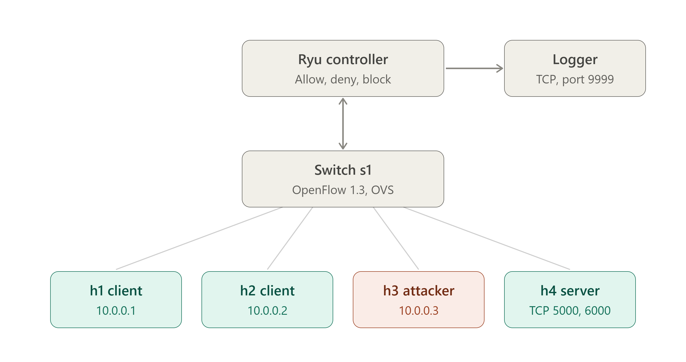

# Dynamic Firewall with Security Event Logger

A Software-Defined Networking (SDN) mini project that filters real TCP application traffic, automatically blocks sources that repeatedly violate policy, and sends security events to a centralized TCP logging server.

**Course:** UE25CS243A SDN-Socket Programming

**Assigned topic:** Project 1 - Dynamic Firewall with Security Event Logger

**Stack:** Python 3, Ryu, Mininet, Open vSwitch, OpenFlow 1.3, TCP sockets

## Overview

Two legitimate clients, a controlled attack client, and an application server connect to one Open vSwitch switch. The Ryu controller evaluates TCP traffic against source, destination, and destination-port rules. Repeated denied packets trigger a temporary source-IP drop rule. When that rule expires, the controller records recovery.

The application server and event logger both use Python's low-level socket API and support concurrent connections through threads.

## Architecture



| Component | Address / port | Purpose |
| --- | --- | --- |
| `h1` | `10.0.0.1` | Client with data and admin access |
| `h2` | `10.0.0.2` | Client with data access only |
| `h3` | `10.0.0.3` | Controlled port-scan traffic generator |
| `h4` | `10.0.0.4:5000`, `:6000` | Data and admin TCP services |
| `s1` | OpenFlow 1.3 | Forwards traffic and enforces installed rules |
| Ryu controller | `127.0.0.1:6653` | Classifies traffic and installs flows |
| Event logger | `127.0.0.1:9999` | Receives newline-delimited JSON events over TCP |

The controller and logger run in the VM's root network namespace. The logger is separate from the application server on `h4`.

### Traffic and event flow

1. A packet without a matching switch flow is sent to the controller.
2. The controller checks the current source block state and TCP policy.
3. Allowed TCP traffic is forwarded. When the destination MAC is known, forward and return rules are installed.
4. Denied TCP packets are dropped and counted in a per-source time window.
5. Reaching the threshold installs a higher-priority IPv4 source drop rule with a hard timeout.
6. Rule expiration produces a `RECOVER` event. Events are sent to the TCP logger and appended to a JSON-lines log.

## Features

- TCP client/server messages: `HELLO`, `ECHO`, `TIME`, and `BYE`.
- Threaded, multi-port application server and multi-client event logger.
- Ordered JSON rules matching source IP, destination IP, and destination TCP port.
- Runtime policy-file reload when a packet reaches the controller.
- Automatic source blocking and timeout-based recovery.
- Events for switch connection, allow, deny, block, recovery, and policy reload.
- Client connection time, application round-trip time, and unanswered-message percentage.
- Configurable Mininet bandwidth, link delay, and packet loss.

## Repository layout

```text
.
|-- apps/
|   |-- client.py                # TCP client and timing output
|   |-- server.py                # Concurrent data/admin services
|   `-- attacker.py              # Controlled connection attempts
|-- controller/firewall_ctrl.py  # Ryu firewall application
|-- config/policy.json           # Ordered policy and blocking settings
|-- logger/log_server.py         # Central TCP event receiver
|-- topo/fw_topo.py              # Four-host, one-switch Mininet topology
|-- logs/.gitkeep                # Runtime logs are ignored by Git
|-- tests/README.md              # Manual demo and test cases
|-- docs/
|   |-- images/                  # Supplied architecture image
|   |-- reference/               # Assignment PDF, workbook, original README
|   |-- results/README.md        # Evidence collection guidance
|   |-- EVALUATION.md            # Baseline and performance experiments
|   `-- REQUIREMENTS.md          # Project expectations and rubric mapping
`-- requirements-controller.txt  # Direct controller dependency versions
```

## Setup

Run the complete SDN lab in a Linux VM with Mininet and Open vSwitch. The socket apps and logger use only the Python standard library. Native Windows alone does not provide the Mininet network used by this project.

The supplied project uses a legacy Ryu/Eventlet stack. The commands below target an **Ubuntu 20.04 lab VM with Python 3.8**, retaining the supplied Eventlet version and packaging workaround. They are a setup starting point, not a verified environment lock. Do not assume these dependency pins work with newer Python versions. Record the environment used for the final demo.

```bash
git clone https://github.com/dakshnayak24/Dynamic-Firewall-with-Security-Event-Logger.git
cd Dynamic-Firewall-with-Security-Event-Logger

sudo apt update
sudo apt install -y mininet openvswitch-switch python3-pip python3-venv
sudo service openvswitch-switch start

python3 --version
python3 -m venv .venv
source .venv/bin/activate
python -m pip install "pip==23.3.2" "setuptools==67.6.1" wheel
python -m pip install -r requirements-controller.txt
ryu-manager --version
sudo python3 -c "import mininet; print('Mininet import OK')"
```

If Mininet is unavailable from the VM's packages, follow the [official Mininet installation guide](https://mininet.org/download/). Ryu's upstream installation instructions are available on [PyPI](https://pypi.org/project/ryu/4.34/).

## Run the project

Open three terminals at the repository root. Start the logger first, then the controller, then the topology.

**Terminal 1 - centralized logger**

```bash
python3 logger/log_server.py --host 127.0.0.1 --port 9999
```

**Terminal 2 - Ryu controller**

```bash
source .venv/bin/activate
ryu-manager --ofp-tcp-listen-port 6653 controller/firewall_ctrl.py
```

**Terminal 3 - Mininet network**

```bash
sudo python3 topo/fw_topo.py
```

The topology starts the application server on `h4` automatically. Its output goes to `logs/server.log`. Security events are appended to `logs/security_events.log` and printed in Terminal 1.

### Quick demo

Enter these commands at the `mininet>` prompt. Check baseline connectivity before triggering a block.

```text
pingall
h1 python3 apps/client.py --server 10.0.0.4 --port 5000 -n 5
h1 python3 apps/client.py --server 10.0.0.4 --port 6000 -n 5
h2 python3 apps/client.py --server 10.0.0.4 --port 6000 -n 1
h3 python3 apps/attacker.py --server 10.0.0.4 --ports 6000-6010
sh ovs-ofctl -O OpenFlow13 dump-flows s1
h3 ping -c 2 10.0.0.4
```

Expected behavior: `h1` can use both services; `h2` is denied admin access; the `h3` scan triggers a `BLOCK` event and a priority-100 source drop rule. During the block, `h3` IPv4 traffic is dropped, including ping. Wait at least 30 seconds after the `BLOCK` event, check for `RECOVER`, then run:

```text
h3 ping -c 2 10.0.0.4
h3 python3 apps/client.py --server 10.0.0.4 --port 5000 -n 5
```

See [the full test procedure](tests/README.md) for concurrency, live policy edits, logger failure, cleanup, and evidence to capture. These are expected outcomes to verify in Mininet.

## Firewall policy

The default [policy](config/policy.json) evaluates rules in order; the first match wins. Omitted match fields default to `"any"`. Ports are JSON numbers or `"any"`. Unmatched TCP traffic is denied.

| Source | Destination | TCP port | Action |
| --- | --- | --- | --- |
| Any | `10.0.0.4` | `5000` | Allow data service |
| `10.0.0.1` | `10.0.0.4` | `6000` | Allow admin service |
| Any other source | `10.0.0.4` | `6000` | Deny admin service |
| Any | Any | Any unmatched port | Default deny |

| Blocking setting | Default | Meaning |
| --- | --- | --- |
| `auto_block` | `true` | Enable automatic temporary source blocking |
| `block.threshold` | `5` | Denied TCP packets needed to trigger blocking |
| `block.window_s` | `10` | Sliding violation window in seconds |
| `block.duration_s` | `30` | Drop-rule hard timeout in seconds |

Change `config/policy.json` while the controller is running to affect later controller-handled decisions. Place specific allow rules before a broader deny. Existing cached allow flows and in-memory return-session entries are not revoked by a policy edit; restart the controller and topology when testing revocation from a clean state.

| Controller variable | Default |
| --- | --- |
| `FW_POLICY` | `config/policy.json` relative to the controller's parent directory |
| `FW_LOGGER_HOST` | `127.0.0.1` |
| `FW_LOGGER_PORT` | `9999` |

## Event logging and measurements

Event types are `SWITCH_CONNECTED`, `ALLOW`, `DENY`, `BLOCK`, `RECOVER`, and `POLICY_RELOAD`. Each event has an epoch timestamp `ts` and an `event` type; the logger adds `received_at` and `from`. Other fields vary by event.

The `BLOCK` event's `response_ms` measures elapsed time from the oldest retained denied packet to the controller's block decision. It includes the time needed to reach the threshold. It does **not** measure confirmed switch enforcement latency. The client's `loss` reports unanswered application messages, not network packet loss.

For the static baseline, set `"auto_block": false` and restart the lab. Rules still deny unauthorized TCP traffic, but repeated violations do not install the temporary source-wide block. Use the same traffic and link settings in both runs. Follow [the evaluation guide](docs/EVALUATION.md) to compare response time, legitimate-client RTT, message completion, and recovery.

## Implementation limits

- Policy enforcement targets IPv4 TCP. ARP and other traffic are forwarded through learning/flooding; active source blocks cover IPv4. This is not a general IPv6 or UDP firewall.
- Violations count denied packets seen by the controller, including TCP retries, rather than unique connections. A single connection attempt may contribute multiple violations.
- Allowed TCP flows use a 30-second idle timeout. Return-session tracking is a simple in-memory tuple set, without full TCP connection tracking or normal session expiry.
- Policy reload is driven by packet-in events. Existing switch rules are not flushed on reload.
- The logger uses plain TCP and a bounded queue. Events can be lost if the queue fills or delivery fails after retries; controller console logs remain available.
- The topology is a single-switch lab and has no alternate-path routing or link-failure recovery.

## Validation and assignment references

All six Python source files and the policy from the supplied ZIP are retained unchanged. The original setup README is preserved under [reference documents](docs/reference/ORIGINAL_README.md).

Local checks: Python syntax, JSON policy parsing, TCP application exchanges with concurrent clients, and concurrent logger ingestion. **The complete Ryu/Mininet/Open vSwitch demo and performance experiments have not been run on the Windows preparation machine. No benchmark results are claimed.**

- [Assignment project list](docs/reference/SDN_Socket_Programming_30_Projects.xlsx) - Project 1 appears in row 2.
- [Guidelines and grading rubric](docs/reference/SDN-Socket%20Programming-Guidelines_Rubrics.pdf).
- [Requirement and rubric mapping](docs/REQUIREMENTS.md).
- [Evaluation procedure](docs/EVALUATION.md) and [results evidence guidance](docs/results/README.md).
